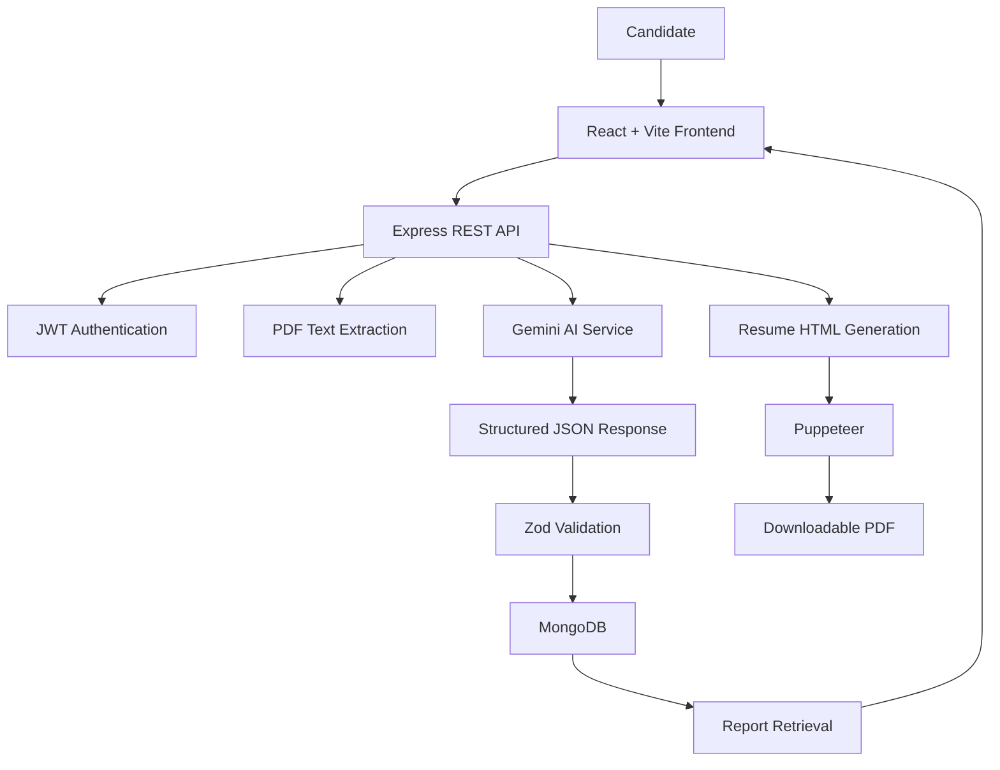

# AI Job Preparation Platform 🚀

**Prepare smarter. Identify skill gaps. Practice with purpose.**

An AI-powered, full-stack web application that helps candidates prepare for job opportunities by analyzing their resumes and target job descriptions, generating personalized interview preparation reports, and creating downloadable PDF resumes.

> Built with React, Node.js, Express, MongoDB, and the Google Gemini API.

\<!-- Replace these placeholders after deployment -->

\<!-- Live Demo: YOUR_DEPLOYED_URL -->

\<!-- Demo Video: YOUR_VIDEO_URL -->

---

## 📌 Table of Contents

- [Overview](#-overview)
- [Features](#-features)
- [How It Works](#-how-it-works)
- [Technology Stack](#-technology-stack)
- [Architecture](#-architecture)
- [Getting Started](#-getting-started)
- [Environment Variables](#-environment-variables)
- [API Overview](#-api-overview)
- [Security and Reliability](#-security-and-reliability)
- [Roadmap](#-roadmap)
- [Project Structure](#-project-structure)
- [Contributing](#-contributing)
- [License](#-license)

---

## 🎯 Overview

Preparing for a job interview requires more than submitting a resume. Candidates need to understand the role's requirements, recognize their skill gaps, prepare for technical and behavioral questions, and present their experience effectively.

The AI Job Preparation Platform brings these activities into one workflow.

Candidates can provide their resume, self-description, and target job description to generate an AI-powered preparation report. The application identifies relevant skills, suggests areas for improvement, produces interview questions with explanations, and creates a structured preparation plan.

The platform also supports generating a downloadable resume PDF using AI-generated HTML and Puppeteer.

### The Problem

- Candidates often struggle to identify which skills matter most for a particular role.
- Generic interview preparation offers limited personalization.
- Preparing technical and behavioral answers can be time-consuming.
- Formatting a professional resume for a specific opportunity requires additional effort.

### The Solution

A centralized job-preparation workflow that connects candidate information, job requirements, interview preparation, and PDF generation.

---

## ✨ Features

### 1. AI-Powered Interview Preparation

Generate an interview preparation report from the candidate's resume, self-description, and target job description.

The report includes:

- **Match score:** An AI-generated estimate of alignment with the role.
- **Technical questions:** Role-relevant technical questions, interviewer intentions, and suggested answer guidance.
- **Behavioral questions:** Questions designed to help candidates prepare for behavioral interviews.
- **Skill-gap analysis:** Potential areas for improvement, classified by severity.
- **Seven-day preparation plan:** A structured plan containing daily focus areas and actionable tasks.

*Note: AI-generated assessments are estimates and should not be treated as objective hiring decisions.*

### 2. Resume Processing

- Accepts uploaded PDF resumes.
- Extracts resume text for use in interview preparation.
- Combines extracted information with the candidate's self-description and job requirements.

### 3. AI Resume Generation

- Generates resume content in HTML using the Gemini API.
- Uses the supplied candidate information and target job description as input.
- Converts the generated HTML into a downloadable PDF using Puppeteer.

Generated content should be reviewed for accuracy before being used in a job application.

### 4. Persistent Interview Reports

- Stores generated reports in MongoDB.
- Associates reports with authenticated users.
- Supports retrieving individual reports and listing report history.

### 5. Authentication

- Uses JWT-based authentication.
- Supports authenticated access to protected application functionality.

### 6. Full-Stack Integration

- React and Vite power the frontend.
- Express exposes backend API endpoints.
- MongoDB stores interview reports.
- Gemini generates structured AI responses.
- Puppeteer converts HTML documents into PDF files.

---

## 🔄 How It Works

1. **Provide candidate information:** Upload a PDF resume, enter a self-description, or provide both.
2. **Add the target job description:** Supply the requirements for the position you want to pursue.
3. **Generate the report:** The backend sends the information to Gemini and requests structured JSON output.
4. **Validate the response:** The application validates the generated report against the expected data structure.
5. **Save the results:** The report is stored in MongoDB and associated with the authenticated user.
6. **Review the report:** Access technical questions, behavioral questions, potential skill gaps, and a preparation plan.
7. **Generate a resume PDF:** Request a generated resume document and download the resulting PDF.

---

## 🛠️ Technology Stack

| Layer               | Technologies                       |
| ------------------- | ---------------------------------- |
| Frontend            | React.js, Vite, JavaScript         |
| Backend             | Node.js, Express.js                |
| Database            | MongoDB, Mongoose                  |
| Authentication      | JSON Web Tokens (JWT)              |
| Generative AI       | Google Gemini API, `@google/genai` |
| Input processing    | `pdf-parse`                        |
| PDF generation      | Puppeteer                          |
| Validation          | Zod                                |
| AI schema utilities | `zod-to-json-schema`               |
| Version control     | Git, GitHub                        |

---

## 🏗️ Architecture

The application follows a client-server architecture.



### Component Responsibilities

- **Frontend:** Collects user inputs and presents interview reports.
- **Backend API:** Coordinates authentication, request validation, AI generation, and persistence.
- **AI service:** Sends prompts to Gemini and validates structured interview report data.
- **Database:** Persists reports for later retrieval.
- **PDF pipeline:** Converts generated resume HTML into PDF documents.

---

## 🚀 Getting Started

### Prerequisites

Install the following before running the application:

- Node.js and npm
- A MongoDB database, such as MongoDB Atlas
- A Google Gemini API key
- Git

### 1. Clone the Repository

```bash
git clone YOUR_GITHUB_REPOSITORY_URL
cd GenAi-Yt
```

Replace `YOUR_GITHUB_REPOSITORY_URL` with your repository URL.

### 2. Configure the Backend

```bash
cd Backend
npm install
```

Create a `.env` file in the `Backend` directory using the variables described in the environment configuration section.

### 3. Start the Backend

Use the development script defined in `Backend/package.json`. If it is configured as `dev`:

```bash
npm run dev
```

Confirm the backend starts and connects to MongoDB successfully.

### 4. Configure the Frontend

Open a second terminal:

```bash
cd Frontend
npm install
```

Create the frontend environment configuration if your Vite application uses an environment variable for the API URL.

For local development, the API URL may be:

```dotenv
VITE_API_URL=http://localhost:3000
```

Use the exact variable name expected by your frontend code.

### 5. Start the Frontend

```bash
npm run dev
```

Open the local URL printed by Vite in your terminal.

> **Note:** The commands above assume the corresponding `dev` scripts exist in each package. Check the respective `package.json` files if your scripts use different names.

---

## 🔐 Environment Variables

### Backend

Create `Backend/.env`:

```dotenv
PORT=3000
MONGODB_URI=your_mongodb_connection_string
GOOGLE_GENAI_API_KEY=your_gemini_api_key
JWT_SECRET=your_long_random_secret
```

These names must match the variables read by your application. Add any other variables your existing configuration requires.

### Frontend

If your frontend reads `VITE_API_URL`, configure it in `Frontend/.env`:

```dotenv
VITE_API_URL=http://localhost:3000
```

For production, replace the local URL with the deployed backend URL.

### Security Notes

- Never commit `.env` files or real credentials to GitHub.
- Keep the Gemini API key on the backend.
- Never expose private secrets through frontend `VITE_*` variables.
- Configure CORS for the intended frontend origin.
- Use HTTPS in production.
- Restrict database access and protect user-owned reports.

---

## 📡 API Overview

The following endpoints reflect the controller functionality implemented in the project. Confirm the exact route paths and HTTP methods in your router configuration before publishing this table.

| Operation                 | Controller functionality            |
| ------------------------- | ----------------------------------- |
| Generate interview report | `generateInterViewReportController` |
| Get report by ID          | `getInterviewReportByIdController`  |
| Get report history        | `getAllInterviewReportsController`  |
| Generate resume PDF       | `generateResumePdfController`       |

### Generate Interview Report

The report-generation controller accepts a job description, an optional self-description, and an optional uploaded resume, subject to the application's validation rules.

The generated report includes a title, match score, technical questions, behavioral questions, skill gaps, and a preparation plan.

### Retrieve Reports

Authenticated users can retrieve an individual report and list their saved reports.

### Download Resume PDF

The resume-generation controller retrieves an existing report and uses its stored candidate information to generate a PDF.

**Before release:** document the actual endpoint paths, HTTP methods, authentication requirements, request fields, and response examples from your router files.

---

## 🛡️ Security and Reliability

The project uses JWT authentication, user-associated report storage, structured AI response validation, and environment-based configuration.

For a production deployment, additional checks should be verified and tested:

- Uploaded-file type and size validation.
- Handling malformed, empty, or scanned PDFs.
- Graceful handling of Gemini API failures and rate limits.
- Validation of AI-generated resume content.
- Authorization checks for every user-owned report and PDF download.
- Safe handling of generated HTML before rendering it in Puppeteer.
- Appropriate request limits, timeouts, and error responses.
- Automated tests for both successful requests and failure cases.

These are important production-readiness checks, not claims that every item is already implemented.

---

## 🗺️ Roadmap

Potential improvements for future versions:

- [ ] Evidence-based resume-to-job skill comparison.
- [ ] More transparent and explainable match scoring.
- [ ] Job-specific resume revisions with before-and-after comparisons.
- [ ] Candidate review and correction of AI-generated resume content.
- [ ] Interactive mock interviews with rubric-based feedback.
- [ ] Progress tracking across interview practice sessions.
- [ ] Automated backend and frontend tests.
- [ ] Rate limiting and more comprehensive request validation.
- [ ] Deployment documentation and a public demo.
- [ ] API documentation with verified request and response examples.

---

## 📁 Project Structure

The repository is organized into separate frontend and backend applications.

```text
GenAi-Yt/
├── Frontend/
│   ├── src/
│   ├── public/
│   ├── package.json
│   └── vite.config.js
│
├── Backend/
│   ├── src/
│   │   ├── controllers/
│   │   ├── models/
│   │   ├── routes/
│   │   └── services/
│   ├── package.json
│   └── .env.example
│
├── .gitignore
└── README.md
```

The directory listing is representative. Adjust it to match the actual files in your repository.

---

## 🤝 Contributing

Contributions, suggestions, and bug reports are welcome.

1. Fork the repository.
2. Create a feature branch.
3. Make your changes and test them.
4. Commit your changes with a descriptive message.
5. Open a pull request describing the improvement.

For bugs, include the steps to reproduce the issue and the expected behavior. Never include API keys, passwords, or private candidate information in issues.

---

## 📄 License

No license has been specified yet. Add a `LICENSE` file before presenting this repository as open source. Choose a license that matches how you want others to use, modify, and distribute your code.

---

## 👨‍💻 About

**AI Job Preparation Platform** is a full-stack application exploring how generative AI can support job preparation through structured interview guidance, resume processing, and PDF generation.

Built as a learning project to develop practical skills in full-stack engineering, API integration, data persistence, and AI-assisted application development.
